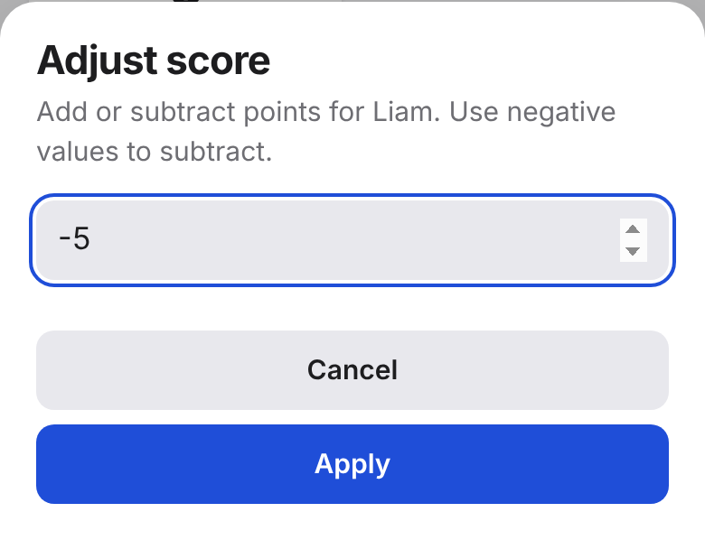

# Change scores

This guide shows you how to add or subtract points, by one or by any amount, and how to set every score back to zero. First [add the players](manage-players.md).

## Change a score by one point

To add a point, select **+** in the player's card. To subtract a point, select **−**.

## Change a score by any amount

1. In the player's card, select the score, the large number in the middle.
2. In the **Adjust score** window, enter the amount in the **Custom score adjustment** field. Enter a positive number such as `12` to add points, or a negative number such as `-12` to subtract them.
3. Select **Apply**. With a keyboard, you can use the Enter key instead.

The window closes and the card shows the changed score. The leaderboard updates at once.

The following image shows the **Adjust score** window with `-5` entered for a player named Liam.

<picture>
  <source media="(prefers-color-scheme: dark)" srcset="../images/change-scores/adjust-score-dark.png">
  
</picture>

To close the window without a change, select **Cancel**. If you enter `0` or leave the field empty, **Apply** changes nothing.

## If a score would pass the limit

A score stays between -999,999 and 999,999. When a change would go past a limit, GG Counter shows a message, for example "Scores go from -999,999 to 999,999. This change would go past the limit.", and keeps the score as it is. For **+** and **−** the message appears under the card. For a custom amount it appears under the field, and the window stays open so you can enter another amount.

## Set every score to zero

To play again with the same players:

1. In the **Leaderboard** card, select **Reset scores**.
2. In the **Reset all scores?** window, select **Reset**.

Every score is 0 and the players stay. You can't undo this. **Reset scores** is also in the window that the trophy button (**Open leaderboard**) in the header opens.

## Related

- [Manage players](manage-players.md)
- [Share the leaderboard](share-leaderboard.md)
- [Settings and limits](../reference/settings.md) — the score limits
- [GG Counter user documentation](../index.md)
