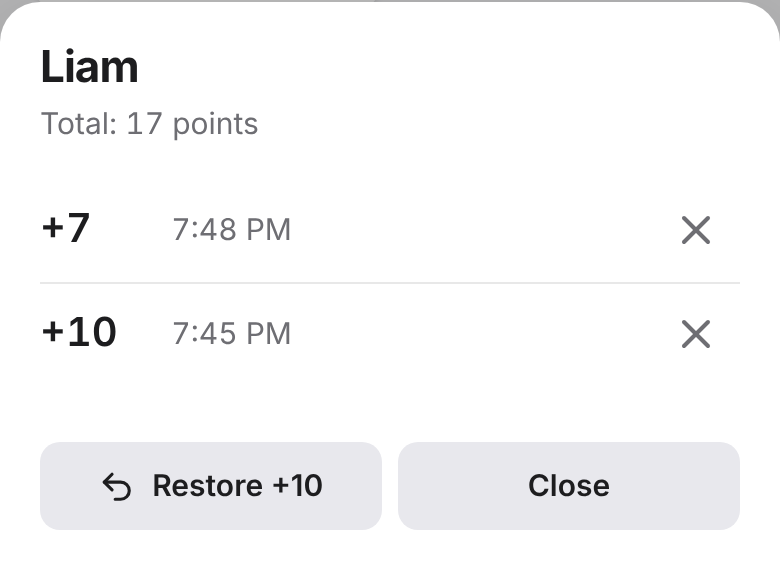

# Change scores

This guide shows you how to add or subtract points, by one or by any amount, how to see and remove recent changes, and how to set one score or every score back to zero. First [add the players](manage-players.md).

## Change a score by one point

To add a point, select **+** in the player's card. To subtract a point, select **−**.

## Change a score by any amount

1. In the player's card, select the score, the large number in the middle.
2. In the **Adjust score** window, enter the amount in the **Custom score adjustment** field. Enter a positive number such as `12` to add points, or a negative number such as `-12` to subtract them.
3. Select **Apply**. With a keyboard, you can use the Enter key instead.

The window closes and the card shows the changed score. The leaderboard updates at once.

The following image shows the **Adjust score** window with `-5` entered for a player named Liam.

<picture>
  <source media="(prefers-color-scheme: dark)" srcset="../images/change-scores/adjust-score-dark.png">
  
</picture>

To close the window without a change, select **Cancel**. If you enter `0` or leave the field empty, **Apply** changes nothing.

## See and remove recent changes

Each player's card shows its most recent changes in a small grey line between the name and the score, for example `+5  −2  +12`. The newest change is at the right end in darker text, and older ones fade out at the left. Taps in a row on **+** or **−** within 3 seconds count as one change, so ten quick taps show as `+10`.

To see every change or take back a wrong one:

1. In the player's card, select the line of changes.
2. The window shows the player's name, the total and the changes, newest first, each with its time. To take one back, select the **×** next to it.

The change is gone at once and the total drops or rises by its points. The card and the leaderboard update too. To put it back, select **Restore** (for example **Restore +12**) before you close the window. The **Earlier points** line holds the points from before the oldest change listed. GG Counter keeps the last 50 changes per player and adds older ones to **Earlier points**. You can't remove that line one change at a time.

The following image shows the window for Liam after **+10** was removed, with **Restore +10** and **Close** at the bottom.

<picture>
  <source media="(prefers-color-scheme: dark)" srcset="../images/change-scores/history-dark.png">
  
</picture>

If removing a change would take the score past a limit, GG Counter says why under that change and keeps it.

## If a score would pass the limit

A score stays between -999,999 and 999,999. When a change would go past a limit, GG Counter shows a message, for example "Scores go from -999,999 to 999,999. This change would go past the limit.", and keeps the score as it is. For **+** and **−** the message appears under the card. For a custom amount it appears under the field, and the window stays open so you can enter another amount.

## Set one score to zero

1. In the player's card, select the trash button (**Remove**, followed by the player's name).
2. In the **Remove player or score?** window, select **Score only**.
3. Select **Reset**.

The player stays with a score of 0 and an empty list of changes. The other scores don't change. You can't undo this.

## Set every score to zero

To play again with the same players:

1. In the **Leaderboard** card, select **Reset scores**.
2. In the **Clear session?** window, **Scores only** is already selected. Select **Reset**.

Every score is 0 and the players stay. You can't undo this. **Reset scores** is also in the window that the trophy button (**Open leaderboard**) in the header opens. The **Clear session** button opens the same window with **Players and scores** selected, so select **Scores only** there to keep the players.

## Related

- [Manage players](manage-players.md)
- [Share the leaderboard](share-leaderboard.md)
- [Settings and limits](../reference/settings.md) — the score limits
- [GG Counter user documentation](../index.md)
