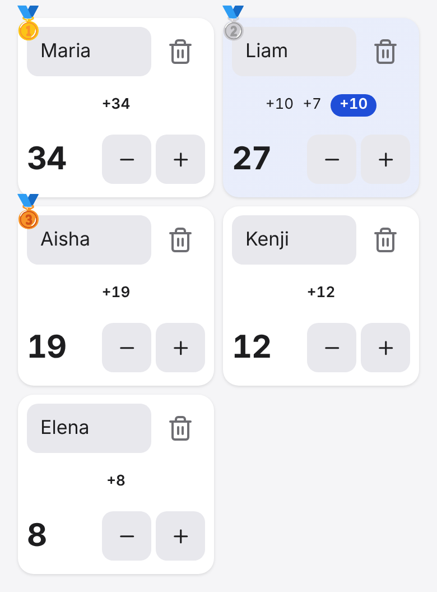

# Manage players

This guide shows you how to put the players of a game into GG Counter, change a name and take a player out.

## Add a player

1. In the **Add Player** card, enter the name in the **Player Name** field.
2. Select **Add**. With a keyboard, you can use the Enter key instead.

The player appears as a card with a score of 0, and the counter in the **Add Player** card counts one more player.

To jump to the **Add Player** card from anywhere on the page, select the plus button (**Add player**) in the header. The name field is ready for typing.

GG Counter removes spaces at the start and end of a name. If the name is blank, nothing happens. If the game has 50 players, or the name is longer than 40 characters, GG Counter shows the reason under the field and adds nobody. See [Settings and limits](../reference/settings.md#limits).

## Rename a player

1. In the player's card, select the name field and edit the name.
2. To save the name, select outside the field or use the Enter key.

The card and the leaderboard show the edited name. If you delete the whole name and leave the field, the previous name comes back. If the name is longer than 40 characters, GG Counter shows the reason under the field and doesn't save the name.

## Read a player card

A card shows, from top to bottom, the name field and the trash button, the most recent score changes (see [Change scores](change-scores.md#see-and-remove-recent-changes)), the score, and the **−** and **+** buttons. The cards stay in the order you added the players. Two marks show how the game stands:

- **A medal in the top-left corner** shows the player's place: 🥇, 🥈 or 🥉. Players with the same score share a place, so 34, 27 and 27 points give 🥇, 🥈 and 🥈. While every score is the same, no card has a medal. The leaderboard uses the same medals.
- **A tinted card** shows the player whose points you entered last. Its newest change also sits in a filled pill. The mark moves each time you enter points, and goes back to the previous player if you remove that change.

The following image shows five player cards. Maria has 🥇, Liam 🥈 and Aisha 🥉. Liam's card is tinted because his points were entered last.

<picture>
  <source media="(prefers-color-scheme: dark)" srcset="../images/manage-players/player-card-dark.png">
  
</picture>

From the fifth player on, the cards get smaller so more fit on the screen. A short score then sits next to **−** and **+**, and wider screens show more cards per row.

## Remove a player

1. In the player's card, select the trash button (**Remove**, followed by the player's name).
2. In the **Remove player or score?** window, keep **Player and score** selected.
3. Select **Remove**.

The player and their score are gone. To keep the player, select **Cancel**. To keep the player and set only their score to zero, select **Score only** in the same window. See [Change scores](change-scores.md#set-one-score-to-zero).

## Remove all players

To start over with an empty game, remove every player at once:

1. Select **Clear session**. It is the button with two circular arrows in the header, and the red text at the bottom of the **Leaderboard** card.
2. In the **Clear session?** window, keep **Players and scores** selected.
3. Select **Clear**.

The game has no players and no scores. You can't undo this. To keep the players and set only the scores to zero, select **Scores only** in the same window. See [Change scores](change-scores.md#set-every-score-to-zero).

## Related

- [Change scores](change-scores.md)
- [Settings and limits](../reference/settings.md) — the limits on players and names
- [GG Counter user documentation](../index.md)
