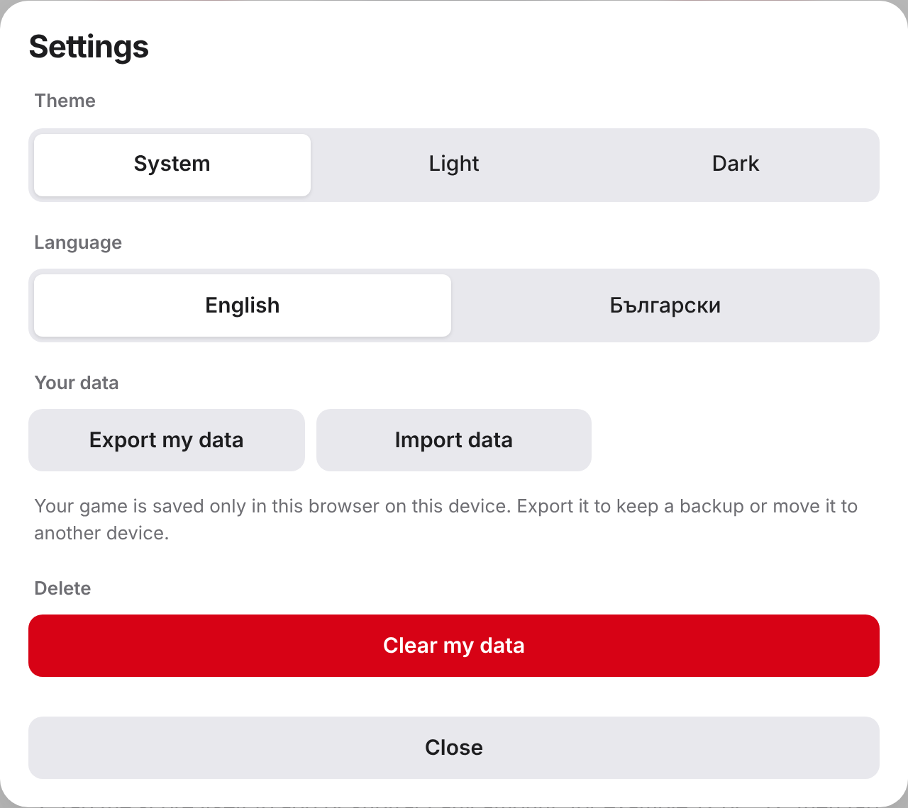

# Manage your data

This guide shows you how to save your game to a file, load it again on this or another device, and delete everything GG Counter saved on a device.

GG Counter saves your game only in the browser on the device you use. The file is the only way to move the game to another device.

## Back up your game

1. Go to **Menu** > **Settings**.
2. Under **Your data**, select **Export my data**.

Your browser saves a file named `gg-counter-data-` followed by the date and `.json`, for example `gg-counter-data-2026-11-19.json`, and GG Counter shows a message that starts with **Saved** and names the file. The file holds the players, their scores, your theme and your language.

The following image shows **Settings** with **Export my data**, **Import data** and **Clear my data**.

<picture>
  <source media="(prefers-color-scheme: dark)" srcset="../images/manage-your-data/settings-dark.png">
  
</picture>

## Restore your game

You can restore a file on the same device or on another one. To move a game, copy the file to the other device first.

1. Go to **Menu** > **Settings**.
2. Under **Your data**, select **Import data**.
3. Choose the file you exported.
4. In the **Replace the current game?** window, select **Replace**.

GG Counter shows **Game imported ✓** and the number of players. The players, scores and theme from the file replace the ones on this device. If the file has a language, that language replaces yours too. You can't undo this. To keep the game on this device, select **Cancel**.

If the file can't be used, a message under the buttons says why, for example that the file comes from another app, is not a `.json` file, is damaged or is too big, and GG Counter changes nothing. The limit is about 1 MB. A real export is far smaller.

## Delete your data

1. Go to **Menu** > **Settings**.
2. Under **Delete**, select **Clear my data**.
3. In the **Delete all your data?** window, select **Delete**.

GG Counter shows **Your data was deleted ✓**. All players, their scores, your theme choice and your language choice are gone from this device. Other apps in the same browser are not affected. You can't undo this, so export your game first if you want a copy.

## Related

- [Settings and limits](../reference/settings.md) — every option in **Settings**
- [Privacy and data](../about/privacy-and-data.md) — what GG Counter saves and where
- [GG Counter user documentation](../index.md)
