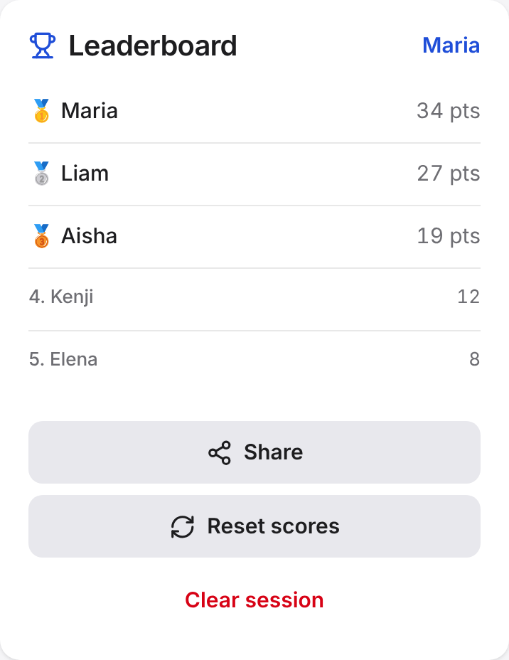

# Share the leaderboard

This guide shows you how to read the ranking and send it to a chat as text. First [add the players](manage-players.md) and [change their scores](change-scores.md).

## Read the leaderboard

The **Leaderboard** card at the end of the page lists the players by score, highest first. The top three have the medals 🥇, 🥈 and 🥉, and the others are numbered. Players with the same score stay in the order you added them. The name of the leader is at the top right of the card.

The trophy button (**Open leaderboard**) in the header opens the same list in a window, so you can check the ranking without scrolling.

<picture>
  <source media="(prefers-color-scheme: dark)" srcset="../images/share-leaderboard/leaderboard-dark.png">
  
</picture>

## Send the leaderboard as text

1. In the **Leaderboard** card, select **Share**.
2. If your device opens a share sheet, choose the app and the chat, and send the message.
3. If there is no share sheet, which is common on computers, GG Counter copies the text and the browser tells you with "Session summary copied to clipboard." Paste the text into any chat, email or document.

**Share** is also in the window of the trophy button, and the share button (**Share session**) in the header does the same.

**Share** in the **Leaderboard** card is turned off while the game has no players.

The shared text looks like the following example. The last line shows the date and time on your device, in its usual format.

```text
🏆 GG Counter Leaderboard

🥇 1st — Maria (34 pts)
🥈 2nd — Liam (27 pts)
🥉 3rd — Aisha (19 pts)
🎲 4th — Kenji (12 pts)
🎲 5th — Elena (8 pts)

🎯 Total score: 100
👥 Players: 5
🕒 Snapshot: 11/19/2026, 10:00:00 AM
```

In Bulgarian, the text has the same emoji and lines with Bulgarian words. The text goes to the app you choose only when you select **Share**, and that app's privacy terms apply after that.

## Related

- [Change scores](change-scores.md)
- [Privacy and data](../about/privacy-and-data.md)
- [GG Counter user documentation](../index.md)
